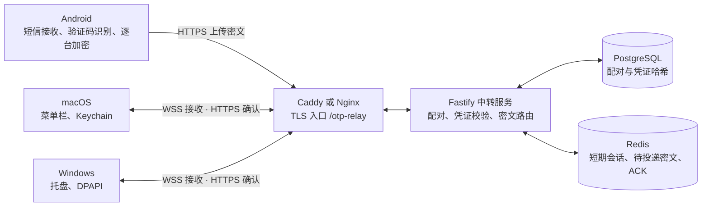
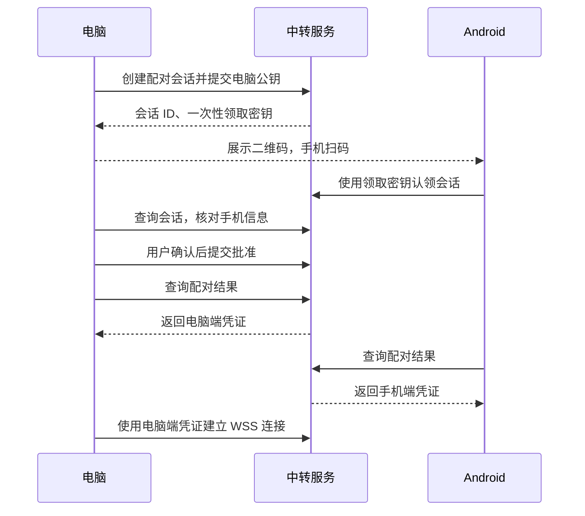

# OTP Relay 技术方案与流程

OTP Relay 是一款可自托管的工具，可将 Android 手机收到的短信验证码端到端加密同步到 macOS 或 Windows。

基于 GitHub 公开版提交 [a3a51e3](https://github.com/gccplus/otp-relay/commit/a3a51e3f56af77be719f4df418ea60b68a4f16aa)。一台手机可绑定多台电脑，每台电脑只保留一条活跃配对。

## 1. 系统架构



| 组件 | 技术 | 职责 |
| --- | --- | --- |
| Android | Kotlin、Compose、WorkManager | 通过 `RECEIVE_SMS` 接收新短信，提取验证码，在本机生成每台电脑的密文，并在网络异常时重试 |
| macOS | Swift、AppKit / SwiftUI、Keychain | 生成配对二维码，接收并解密验证码，提供菜单栏展示和复制 |
| Windows | Electron、`safeStorage`（DPAPI） | 与 macOS 共用 V1 协议，提供托盘展示、复制和本机加密存储 |
| 中转服务 | Node.js、TypeScript、Fastify | 管理配对、分角色鉴权、短期密文投递、ACK 和解绑 |
| 数据层 | PostgreSQL、Redis | PostgreSQL 持久化配对及凭证验证数据。Redis 保存有过期时间的会话、密文和 ACK 记录，关闭持久化 |

## 2. 设备配对



配对会话有效期为 5 分钟。二维码携带服务地址、会话 ID、一次性领取密钥、电脑 P-256 公钥和协议版本。每条配对拥有独立的 `pairingId`、手机端凭证和电脑端凭证。V1 的 `macPublicKey`、`macDeviceId` 和 `/v1/mac/stream` 命名同样适用于 Windows。

## 3. 验证码投递

1. **手机识别。** Android 合并同一条多段短信，在本机提取验证码。识别规则过滤普通短信和候选冲突，并通过本机 HMAC 指纹抑制 60 秒内的重复短信。
2. **逐台加密。** 手机为每条活跃配对生成独立的临时 P-256 密钥对、`messageId` 和随机 nonce。手机临时私钥与电脑长期公钥进行 ECDH，通过 HKDF-SHA256 派生消息密钥，再用 AES-256-GCM 加密验证码载荷。协议版本、消息 ID、配对 ID 和过期时间通过 AAD 参与认证。
3. **上传与中转。** WorkManager 携带对应配对的 Bearer 凭证上传密文信封。服务端校验凭证和配对归属，以 `messageId` 做幂等处理。在线电脑走 WSS 推送，离线电脑重连时补发仍有效的密文。
4. **电脑确认。** 电脑用本机私钥派生同一消息密钥，校验并解密。处理后发送 `displayed` 或 `rejected` ACK，服务端据此删除待投递密文，并短期保留 ACK 记录处理重复请求。

短信正文留在 Android 处理环节。加密载荷包含验证码、来源、用途和接收时间。服务端可见配对和路由元数据，以及信封的时间字段。待投递密文有效期最多 5 分钟，桌面验证码历史保留 24 小时。两种时限分别约束投递和已接收的本机记录。

## 4. 密钥交换与设备凭证

**密钥交换。** 配对时，电脑的长期 P-256 公钥通过二维码交给手机。每次投递时，手机的临时 P-256 公钥随密文信封经云端转发。手机用临时私钥和电脑长期公钥计算 ECDH 共享秘密，电脑用长期私钥和手机临时公钥计算出相同的共享秘密。双方再以同一配对 ID 和消息 ID 为输入，用 HKDF-SHA256 派生相同的 AES 密钥。私钥和 AES 密钥留在各自设备上。

**Bearer 凭证。** 配对经批准后，服务端为手机和电脑分别签发设备凭证。设备通过 HTTPS 请求或 WSS 握手的请求头提交凭证。

```http
Authorization: Bearer <设备凭证>
```

手机凭证用于上传该配对的密文。电脑凭证用于接收密文和回传 ACK。服务端按角色、配对关系和撤销状态校验凭证。二维码中的 `claimSecret` 只用于认领配对会话，设备凭证用于调用中转接口，AES 密钥用于保护验证码内容。泄露电脑凭证可能让持有者以该电脑身份接收密文或发送 ACK。解密仍需要电脑私钥。

## 5. 异常与解绑

| 场景 | 处理 |
| --- | --- |
| 手机暂时无法上传 | WorkManager 按退避策略重试，过期消息停止投递 |
| 电脑离线或 WSS 断开 | 电脑重新连接后补发仍有效的密文 |
| 多台电脑只有部分投递成功 | 各配对独立发送，手机日志可展开查看每台电脑的结果 |
| 重复上传或重复 ACK | 按消息 ID 幂等处理 |
| 任一端解绑 | 云端撤销对应配对凭证并断开该电脑连接，其他配对继续工作 |
| Redis 重启 | 短期会话和未投递密文可能丢失，持久化的配对关系由 PostgreSQL 保存 |

## 6. 部署与验收

1. **开发联调。** 在服务端目录执行 `npm ci` 和 `npm run dev`，以内存模式启动。验证服务端类型检查与测试，以及三个客户端各自的构建和测试。
2. **部署服务。** 准备 HTTPS 域名，配置生产环境变量，通过 Docker Compose 启动服务、PostgreSQL、Redis 和 Caddy。已有 Nginx 时，配置 `/otp-relay/` 路由，保留 WebSocket Upgrade。
3. **验证入口。** 检查 `/otp-relay/healthz` 和 `/otp-relay/readyz`，在电脑端填入自托管域名，再用 Android 扫码完成配对。
4. **验收投递。** 从 Android 发送测试消息，再用脱敏模拟短信验证识别。覆盖两台电脑同时接收、短暂离线后补发、过期不展示、重复发送和单台解绑。

[协议字段与加密细节](protocol-v1.md) · [服务端部署说明](../server/README.md)
